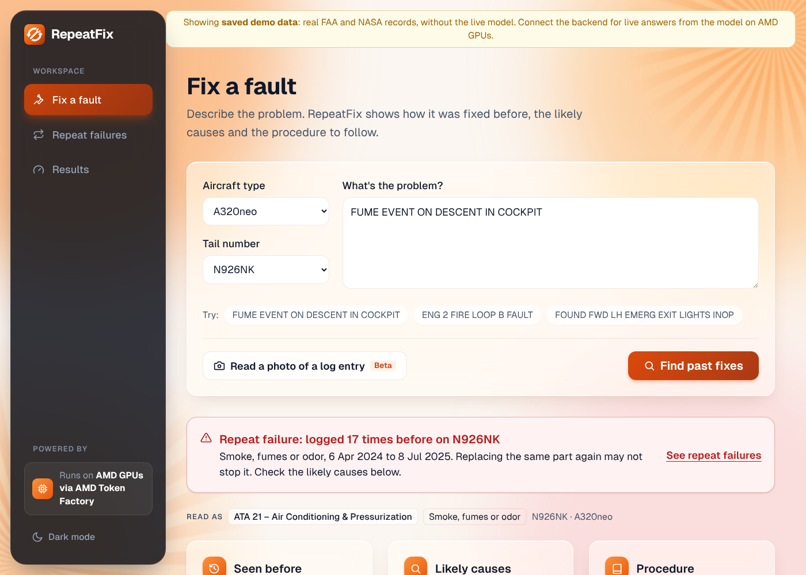

# RepeatFix

**Repeat-failure hunter for messy maintenance logs, running on AMD GPUs via AMD Token Factory.**

RepeatFix reads messy aviation maintenance records (NASA ASRS mechanic reports and FAA Service Difficulty Reports) and turns them into structured job cards. From those it finds the aircraft and components that keep failing. When a new fault comes in, it gives the technician the most similar past fixes, the likely causes and the matching FAA procedure (AC 43.13-1B), with citations. It also drafts a work order for a supervisor to approve. All model inference runs on AMD GPUs through AMD Token Factory, the model API the hackathon is hosted on.

**Live app:** https://repeatfix.vercel.app



## What we found in the FAA records
- **16,473 repeat problems** in 179,962 FAA Service Difficulty Reports (Jan 2024 to Oct 2026): the same problem on the same aircraft and ATA chapter, at least 7 days apart.
- **13% of recorded fixes didn't stick:** in 5,010 of 38,937 system fixes, the same problem came back on the same aircraft within 90 days ([scripts/build_insights.py](scripts/build_insights.py)). The FAA only holds what operators report, so the real figure is likely higher.
- **One aircraft, N926NK (A320neo), logged the same cabin fume problem 17 times.**

## Run it
```bash
# Backend (needs VLLM_BASE_URL and VLLM_API_KEY for AMD Token Factory in backend/.env)
cd backend && pip install -r requirements.txt && uvicorn app.main:app --port 8001
# Frontend (uses the saved demo data when no backend is set)
cd frontend && npm install && npm run dev   # http://localhost:3000
```
Point the frontend at the backend with `NEXT_PUBLIC_API_URL=http://localhost:8001` in `frontend/.env.local`.

## About us
We're Shamveel Mazhar and Nida Amir, and we're building RepeatFix for the AMD Developer Hackathon: ACT III (lablab.ai). Nida owns the backend (the model calls, FastAPI, the data pipelines) and I own the frontend, the data work and the submission.

- Plan and schedule: [PLAN.md](PLAN.md)
- Contributor guide and team conventions: [CLAUDE.md](CLAUDE.md)
- API contract: [docs/API.md](docs/API.md)
- Data sources: [scripts/download_data.md](scripts/download_data.md)

*Data: public US Government sources (NASA ASRS, FAA SDR, FAA AC 43.13-1B, FAA AMT Handbook).*

Code licensed under the [MIT License](LICENSE).
